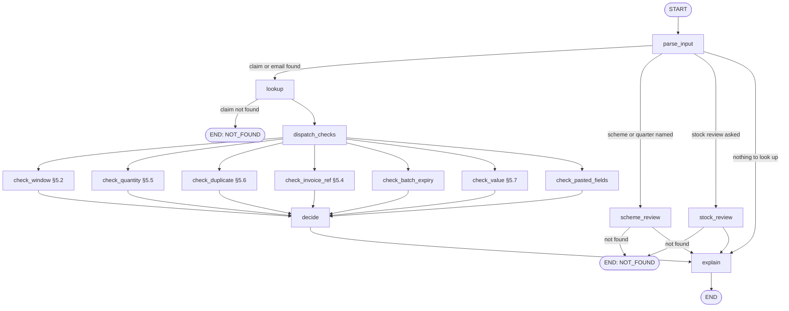

# Project Sankalp: claims screening copilot

A pilot for the **Commercial Finance claims team** in a fictional pharma trade channel. It checks each expiry, breakage or short-supply claim against trade policy **CO-POL-014** and routes it to **Recommend credit**, **Reject**, **Needs a person**, or **Not found**. Every result shows the policy clause and the source rows it used.

> Fictional teaching case by FDE Academy. Pfizer Limited is not involved. All people, figures and records are invented.

## Live demo

- App: **https://project-pfizer.vercel.app/**
- **Demo cases with the LangGraph flow: https://project-pfizer.vercel.app/demos.** Eleven hand-checked cases, one per outcome (credit, reject, needs a person, not found, scheme, stock, free text). Each shows its expected result, then the live answer, the evidence, and the route through the graph lit up step by step: yellow = model, white = code, each check green / red / amber by result.
- Health check: **https://project-pfizer.vercel.app/api/health**

## The problem

- **Expiry claims are above the CFO's 1% target.** The gap is about ₹1.46 cr a year averaged over 30 months, and ₹1.99 cr in the first half of FY27 alone. Quarter-end schemes and a stale allocation split are the main causes.
- **Claim controls leak money.** Two people settle about 4,000 claims a year without checking billing history. Per year: ₹15.7 lakh credited outside the policy window and ₹4.5 lakh in repeat credits (stopped by the rules), plus ₹43 lakh credited with no invoice reference (at risk: sent to a person, not counted as saved).
- **A new forecast tool isn't the fix.** The national forecast is stable; the losses come from schemes, allocation and claim checks.

Details, methods and source rows: [Discovery note](pfizer-channel-engagement_learner-pack/discovery/Discovery_note.md).

## Using the page

- **Four sections, one per job.** The cards at the top say who each section is for, how often, and the question it answers: claim review, batch review, scheme check, stock risk.
- **Claim search.** Type a claim number, stockist, city, SKU or batch; the dropdown lists matching claims (pending first, with stockist, type, date, product, batch, status and ₹). Pick one to review it. A pasted email or claim details still goes through the AI parser. Code only: `GET /api/claims/search`.
- **Each result** shows the answer, *why* (each check that did not pass, with its rule), the *next step* (written by code for each outcome), who decides, and the explanation labelled **written by AI, then checked by code** or **written by code** when the AI's text failed the guard. Check tables use plain names and coloured results; source rows are one tap away.

## Users

1. **Claims executive, Commercial Finance** (owner: Neha Bansal, Controller). Each week: credit, reject, or send each claim in the register to a person.
2. **Commercial Finance with the National Sales Manager** (Arjun Sethi) **and the CFO** (Rohan Mehta). Each quarter: check the quarter-end schemes against the 3% cap and the 1.5× minimum order (section 3 of the page).
3. **Head of Supply Chain** (Kavita Rao). Each month-end: which batches are at expiry risk, and which C&Fs are short or ageing (section 4 of the page).

## How it works



- **Claims** run seven checks in parallel; `check_pasted_fields` compares details pasted in an email with the register. **Schemes** and **stock** take their own branch and never touch the claim checks. Batch mode runs the same claim checks with no model calls.
- **Code does every rule, date, join and sum**, and decides the route. Policy numbers live in [`config.py`](pfizer-channel-engagement_learner-pack/starter/config.py) with their clause references.
- **The model only** reads messy claim emails into fixed fields and writes a plain-language explanation of the result. It never approves a claim or invents a number.

Full design: [Architecture note](pfizer-channel-engagement_learner-pack/discovery/architecture_note.md) · [Decision log](pfizer-channel-engagement_learner-pack/discovery/decision_log.md)

## Accuracy

A hand-checked [check set](pfizer-channel-engagement_learner-pack/starter/checks/check_set.csv) of 16 real claims and emails, plus 3 scheme, 2 stock and 1 free-text case:

| Version | Score |
|---|---|
| Starter tool loop (baseline) | 6/16 |
| Claims workflow graph | **16/16** |
| With the scheme check | **19/19** |
| With the stock view and free-text case (current) | **22/22** |
| Held-out cases, labelled after the build | 3/6 at first; 6/6 after two fixes built against them |
| **Held-out round 2:** 8 cases drawn at random, labelled before running | **8/8** |

The first held-out run exposed two gaps (pasted details not compared, pending repeats missed). Both are fixed, so round 1 is no longer unseen. Round 2 (6 random claims, 1 scheme quarter, 1 stock snapshot) was labelled by hand and committed before the app ran on it; see the [architecture note](pfizer-channel-engagement_learner-pack/discovery/architecture_note.md#5-accuracy).

## Scheme check: quarter-end schemes (problem 1)

Section 3 of the page, or ask "Review quarter-end scheme FY25 Q3". Code checks a quarter or scheme code (e.g. `QS-FY27Q1-A`) against the §4.4 3% free-goods cap and Annexure B: 1.5× minimum order, validity window, SKU list, free ratio. §4.5 stock norm is shown as not checkable (no secondary sales). Per year over 10 quarters: **₹1.58 cr above the cap**, and **₹50.2 L–₹2.63 cr** of free goods on orders below the 1.5× minimum. The range depends on how the policy's "average monthly purchase" is read; that's an open question for the client. Commercial Finance and the National Sales Manager decide.

## Stock and expiry risk: second user (problem 2)

Section 4 of the page, or ask "Stock review" (latest month-end) or "Stock review 31-12-2025". For Kavita Rao, Head of Supply Chain: with first-expiry-first-out picking at each C&F's current outward rate, code finds stock that will ship below the 60% shelf-life norm or hit the 60-day block (CO-POL-014 §7.1–7.2); out-of-stock lines; cover above the 2-month top-up norm (C&F agreement §2.2); and each C&F's share of dispatches that skipped older stock. At 30 Sep 2026: **₹2.06 cr below the norm** (₹1.22 cr at Kolkata; not a write-off), **Lucknow out of stock on 23 of 36 SKUs**, and **Kolkata skipped older stock on 83% of dispatches** against 28–35% elsewhere after its Feb 2026 WMS change, a signal to check its picking rules.

## Batch mode: what the pilot would have caught

`POST /api/batch` (and section 2 of the page) runs every register claim, or one financial year, quarter or month, through the same checks with no model calls. Over 30 months, per year: **₹19.94 L of credited leakage the rules stop** (reconciles to the discovery note's ₹20.25 L), and **₹86.26 L credited without the checks passing**, which goes to a person and is counted as at risk, not saved.

Run it from `pfizer-channel-engagement_learner-pack/starter`:

```bash
python checks/run_checks.py
```

## Run locally

```bash
cd pfizer-channel-engagement_learner-pack/starter
python -m venv .venv
source .venv/bin/activate            # Windows: .venv\Scripts\activate
pip install -r requirements.txt pytest httpx uvicorn
cp .env.example .env                 # add OPENROUTER_API_KEY and MODEL
pytest -q
uvicorn app:app --reload             # open http://127.0.0.1:8000
```

Deployed on Vercel (Hobby) with root directory `pfizer-channel-engagement_learner-pack/starter` and the env vars `OPENROUTER_API_KEY` and `MODEL`.

## Repo map

| Path | What it is |
|---|---|
| `pfizer-channel-engagement_learner-pack/discovery/Discovery_note.md` | Ranked problems in ₹, evidence, owners, view on the CFO's ask |
| `pfizer-channel-engagement_learner-pack/discovery/architecture_note.md` | Graph, code vs model split, failure handling, cost |
| `pfizer-channel-engagement_learner-pack/PDFs/` | The submitted PDFs: discovery note, architecture note, deck |
| `pfizer-channel-engagement_learner-pack/discovery/Project_Sankalp_deck.pptx` | 10-slide deck on the FDE Academy template, with speaker notes |
| `pfizer-channel-engagement_learner-pack/discovery/money_summary.md` | Every ₹ figure on one page: method, source, and stopped / at risk / context |
| `pfizer-channel-engagement_learner-pack/discovery/research_note.md` | Trade-channel terms, laws read at source, and why the problems happen |
| `pfizer-channel-engagement_learner-pack/discovery/decision_log.md` | Design choices and why |
| `pfizer-channel-engagement_learner-pack/discovery/sizing.py` | Reproduces every ₹ figure (writes `sizing_results.csv`) |
| `pfizer-channel-engagement_learner-pack/starter/` | The app: FastAPI, LangGraph graph, frontend |
| `pfizer-channel-engagement_learner-pack/starter/agent/` | `graph.py` (the workflow), `rules.py` (policy rules), `schemes.py` (scheme check), `stock.py` (stock view), `batch.py` (batch mode), `data.py`, `tools.py`, `prompts.py`, `llm.py` |
| `pfizer-channel-engagement_learner-pack/starter/tests/` | Tests for rules, data, graph and API |
| `pfizer-channel-engagement_learner-pack/starter/checks/` | Check set and runner |
| `pfizer-channel-engagement_learner-pack/brand/` | Project Sankalp logo: SVG, PNG for slides, white-text version for dark slides |
| `pfizer-channel-engagement_learner-pack/data-pack/` | The client documents, CSV extracts and voice notes |

## Limits

- Read-only: it never posts credit notes or writes to SAP or WMS. A named person decides.
- Runs on static extracts from the case, not live data.
- Claims without an invoice reference always go to a person, because the Area Manager approval required by §5.4 isn't in the data.
