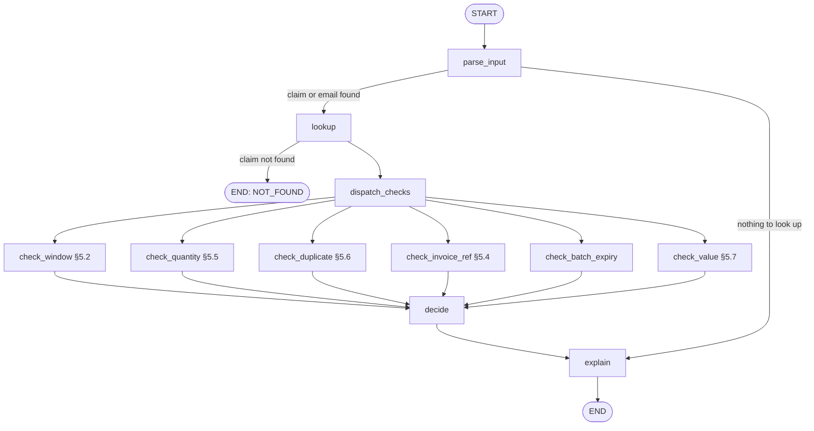

# Project Sankalp: claims screening copilot

A pilot for the **Commercial Finance claims team** in a fictional pharma trade channel. It checks each expiry, breakage or short-supply claim against trade policy **CO-POL-014** and routes it to **Recommend credit**, **Reject**, **Needs a person**, or **Not found**. Every result shows the policy clause and the source rows it used.

> Fictional teaching case by FDE Academy. Pfizer Limited is not involved. All people, figures and records are invented.

## Live demo

- App: **https://project-pfizer.vercel.app/**
- Health check: **https://project-pfizer.vercel.app/api/health**

Try these inputs:

| Input | Expected result |
|---|---|
| `CLM-2404-04177` | Recommend credit (all checks pass) |
| `CLM-2605-04488` | Reject: repeat credit of an earlier claim (§5.6) |
| `CLM-2404-04181` | Needs a person: no invoice reference (§5.4) |
| `CLM-0000-00000` | Not found |
| `EML-017` | Needs a person: email tries to bypass the rules, and is ignored |

## The problem

- **Expiry claims are above the CFO's 1% target.** The gap is about ₹1.46 cr a year averaged over 30 months, and ₹1.99 cr in the first half of FY27 alone. Quarter-end schemes and a stale allocation split are the main causes.
- **Claim controls leak money.** Two people settle about 4,000 claims a year without checking billing history. Per year: ₹43 lakh credited with no invoice reference, ₹15.7 lakh outside the policy window, ₹4.5 lakh in repeat credits.
- **A new forecast tool isn't the fix.** The national forecast is stable; the losses come from schemes, allocation and claim checks.

Details, methods and source rows: [Discovery note](pfizer-channel-engagement_learner-pack/discovery/Discovery_note.md).

## Users

1. **Claims executive, Commercial Finance** (owner: Neha Bansal, Controller). Each week: credit, reject, or send each claim in the register to a person.
2. **Head of Supply Chain** (Kavita Rao). Which batches are at expiry risk, and which C&Fs are short. Planned second view.

## How it works



- **Code does every rule, date, join and sum**, and decides the route. Policy numbers live in [`config.py`](pfizer-channel-engagement_learner-pack/starter/config.py) with their clause references.
- **The model only** reads messy claim emails into fixed fields and writes a plain-language explanation of the result. It never approves a claim or invents a number.

Full design: [Architecture note](pfizer-channel-engagement_learner-pack/discovery/architecture_note.md) · [Decision log](pfizer-channel-engagement_learner-pack/discovery/decision_log.md)

## Accuracy

A hand-checked [check set](pfizer-channel-engagement_learner-pack/starter/checks/check_set.csv) of 16 real claims and emails:

| Version | Score |
|---|---|
| Starter tool loop (baseline) | 6/16 |
| Claims workflow graph (current) | **16/16** |
| Held-out cases, labelled after the build (current) | 3/6 |

The three held-out misses are known gaps, listed in the [architecture note](pfizer-channel-engagement_learner-pack/discovery/architecture_note.md#5-accuracy).

Run it from `pfizer-channel-engagement_learner-pack/starter`:

```bash
python checks/run_checks.py
```

## Run locally

```bash
cd pfizer-channel-engagement_learner-pack/starter
python -m venv .venv
source .venv/bin/activate            # Windows: .venv\Scripts\activate
pip install -r requirements.txt pytest httpx uvicorn
cp .env.example .env                 # add OPENROUTER_API_KEY and MODEL
pytest -q
uvicorn app:app --reload             # open http://127.0.0.1:8000
```

Deployed on Vercel (Hobby) with root directory `pfizer-channel-engagement_learner-pack/starter` and the env vars `OPENROUTER_API_KEY` and `MODEL`.

## Repo map

| Path | What it is |
|---|---|
| `pfizer-channel-engagement_learner-pack/discovery/Discovery_note.md` | Ranked problems in ₹, evidence, owners, view on the CFO's ask |
| `pfizer-channel-engagement_learner-pack/discovery/architecture_note.md` | Graph, code vs model split, failure handling, cost |
| `pfizer-channel-engagement_learner-pack/discovery/research_note.md` | Trade-channel terms, laws read at source, and why the problems happen |
| `pfizer-channel-engagement_learner-pack/discovery/decision_log.md` | Design choices and why |
| `pfizer-channel-engagement_learner-pack/discovery/sizing.py` | Reproduces every ₹ figure (writes `sizing_results.csv`) |
| `pfizer-channel-engagement_learner-pack/starter/` | The app: FastAPI, LangGraph graph, frontend |
| `pfizer-channel-engagement_learner-pack/starter/agent/` | `graph.py`, `rules.py`, `data.py`, `prompts.py`, `llm.py` |
| `pfizer-channel-engagement_learner-pack/starter/tests/` | Tests for rules, data, graph and API |
| `pfizer-channel-engagement_learner-pack/starter/checks/` | Check set and runner |
| `pfizer-channel-engagement_learner-pack/data-pack/` | The client documents, CSV extracts and voice notes |

## Limits

- Read-only: it never posts credit notes or writes to SAP or WMS. A named person decides.
- Runs on static extracts from the case, not live data.
- Claims without an invoice reference always go to a person, because the Area Manager approval required by §5.4 isn't in the data.
