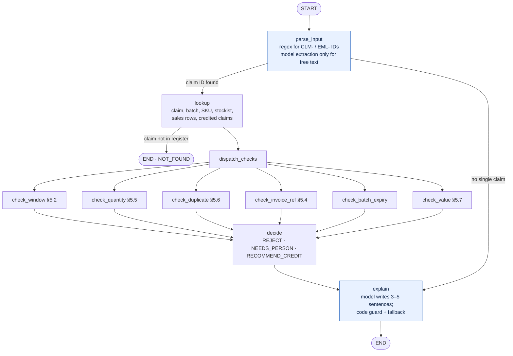

# LangGraph workflow

This diagram shows the compiled graph in `starter/agent/graph.py`. Blue nodes call the model; every other node is plain Python. The node table, check rules and decide order are in [architecture_note.md](architecture_note.md).

