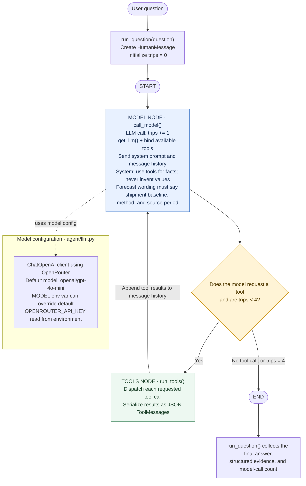
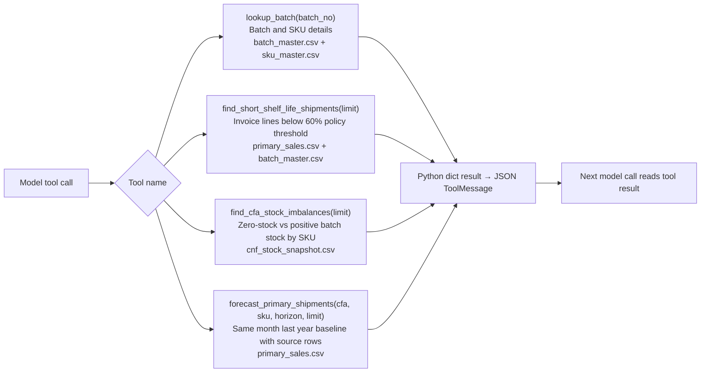

# LangGraph workflow

This diagram reflects the current implementation in `starter/agent/graph.py`. The diamond explains the conditional routing in `route()`; it is not a separate LangGraph node.

## Tools called by the tools node

These are registered Python tool functions in `starter/agent/tools.py`. They are dispatched inside the single LangGraph `tools` node; they are not separate nodes in the compiled graph.

## Call behavior

- The model can answer after its first call, or request one or more registered tools.
- A tool result returns to the model as a `ToolMessage`; the model may answer or request another tool.
- `MAX_TRIPS = 4` counts **model calls**, not tool calls. If the fourth model call still asks for tools, the graph ends without running another tools-node pass.
- A simple question that needs one tool normally uses two model calls: one to choose/call the tool and one to form the answer. Actual calls vary by question.
- The graph does not enforce user approval or perform write-back. Tools read the supplied CSV data and return evidence.
- The forecast tool is a deterministic primary-shipment baseline. It does not forecast downstream demand or promise an accuracy level for a specific CFA/SKU.

## Files behind this graph

- [Graph and routing](../starter/agent/graph.py)
- [Model/provider configuration](../starter/agent/llm.py)
- [Tool implementations](../starter/agent/tools.py)
