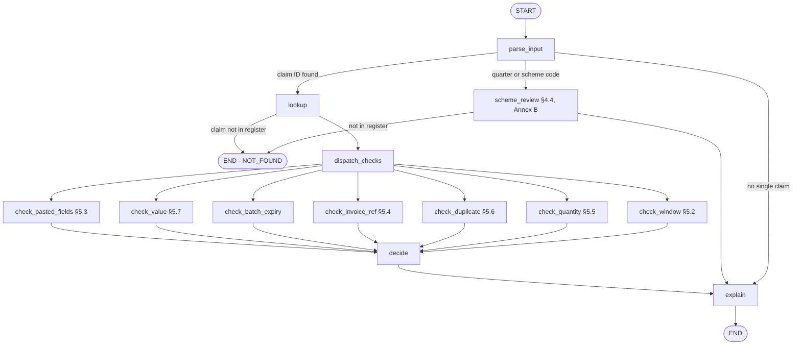

# Project Sankalp: architecture note

**As built · checked against `starter/agent/graph.py` on 24 November 2026 · Fictional training case**

## 1. User, decision, and the split

**User:** Commercial Finance (owner Neha Bansal, Controller). **Decisions:** weekly, credit, reject, or send each register claim to a person; quarterly, check each quarter-end scheme's cost and compliance with the National Sales Manager, Rohan Mehta (§4.3). Read-only: no credit notes, no SAP/WMS writes. **Code decides; the model only parses and explains.** Every rule, date, join and sum is Python; policy numbers sit in [`config.py`](../starter/config.py) with their clause, rules in [`agent/rules.py`](../starter/agent/rules.py). The model can never change the route.

## 2. Graph

| Node | Code or model | Why | File |
|---|---|---|---|
| `parse_input` | Code first: regex for `CLM-YYMM-NNNNN` and `EML-NNN`. **Model only for free text:** no ID, or an ID plus pasted details. Structured output into `ClaimExtraction` (no decision field); code keeps a value only if its digits appear in the text. | Claim and email IDs are exact, so a model adds risk. Messy free text needs extraction. | `agent/graph.py`, `agent/prompts.py` |
| `lookup` | Code | Fetches claim, batch, SKU, stockist, sales rows and same-batch claims via indexes, each with `source_file` and `source_row`. | `agent/data.py` |
| seven `check_*` nodes | Code, in parallel within one superstep | Each check returns `pass`, `fail`, `review` or `missing`, plus a reason, a clause and the cited rows. | `agent/graph.py`, `agent/rules.py` |
| `decide` | Code | Applies a fixed route priority (below). | `agent/graph.py` |
| `scheme_review` | Code | One quarter or scheme code: §4.4 3% cap, Annexure B 1.5× minimum order, validity window, SKU list, free ratio; §4.5 stock norm marked `missing` (no secondary sales). Order lines group split-batch rows. | `agent/schemes.py`, `config.py` |
| `explain` | **Model**, code-guarded | 3–5 sentences. Any number not in the checks, approval or "has been done" wording, or wrong length → code fallback text. | `agent/graph.py`, `agent/prompts.py` |

## 3. Checks, data and clauses

| Check | CSVs it reads | Rule | Clause |
|---|---|---|---|
| `window` | `expiry_claims`, `batch_master` (expiry claims); `primary_sales` invoice date (breakage, short supply) | The type comes from the dates, not the label. Near expiry: −90 to 0 days; expired: 0 to +90; transit: ≤ 7 days after invoice. Inclusive. | §5.2 |
| `quantity` | `primary_sales`, all rows for the stockist and batch | Claimed packs ≤ invoiced + free packs. | §5.5 |
| `duplicate` | `expiry_claims`, all earlier claims on the stockist and batch | Same quantity already credited → `fail`. Same quantity still pending, or within 1% / 1 pack (a pilot threshold in `config.py`, set from the register) → `review`. | §5.6 |
| `invoice_ref` | `expiry_claims`, `primary_sales` | The reference must be present and match a sales row. If not, `missing`: §5.4 needs a ledger check and the Area Manager's written approval, which are not in the data. | §5.4 |
| `batch_expiry` | `expiry_claims`, `batch_master` | The claimed expiry must equal the batch-master expiry. | §5.2 / §5.3 |
| `value` | `expiry_claims`, `sku_master` | Claim value = quantity × PTS, using Decimal arithmetic. | §5.7 |
| `pasted_fields` | pasted text vs `expiry_claims`, `batch_master` | Runs only on pasted details: batch, stockist, SKU, quantity, value, invoice and expiry month must match the register; any conflict → `review`. | §5.3, §5.7 |

**Decide rules, in order:** (1) any `fail` on window, duplicate or quantity → **REJECT**; (2) the input was an email (`EML-`) → **NEEDS_PERSON**, because correspondence is untrusted; (3) any other `fail`, `review` or `missing` → **NEEDS_PERSON**; (4) otherwise → **RECOMMEND_CREDIT**. If the claim isn't in the register → **NOT_FOUND**, with no model call.

**Batch mode** (`POST /api/batch`): a second compiled graph runs `lookup → checks → decide` with no model over all 4,503 claims (≈25–33 s, cached) or one month. Routes: 2,104 recommend credit, 532 reject, 1,867 needs a person. Per year, already credited: **₹19.94 L leakage the rules stop** (whole credit for §5.2/§5.6 failures, excess packs only for §5.5; reconciles to the discovery note's ₹20.25 L), ₹42.00 L whole value of rejected claims, **₹90.41 L at risk** (sent to a person; not counted as saved), plus ₹6.58 L of pending claims it would block.

**Scheme check** (all 10 quarters, per year): free goods above the 3% cap **₹1.58 cr** (matches `sizing.py`); free goods on orders below the 1.5× minimum **₹50.2 L–₹2.63 cr**. The range comes from two readings of "average monthly purchase" (all purchases, the policy wording, is the upper end); the client must confirm. Window and SKU list: no breaches; free ratio: 1–2 lines a quarter.

## 4. Failure handling

| Failure | Response | Test (in `tests/`) |
|---|---|---|
| Unknown claim, scheme code or quarter | `NOT_FOUND`, 0 model calls | `test_ask_not_found_does_not_call_model` (+1) |
| Email says skip checks (EML-017) | Body tagged untrusted; `NEEDS_PERSON`; "APPROVED" text dropped | `test_ask_keeps_eml_017_untrusted_and_never_approves` (+1) |
| Free text, no claim number | `NEEDS_PERSON` | `test_unidentifiable_free_text_is_routed_to_a_person` |
| Provider down or key missing | Parse → `NEEDS_PERSON`; explain → code text, route kept | `test_provider_failure_during_parse_routes_to_a_person` (+1) |
| Pasted details conflict or can't be read | `NEEDS_PERSON` with both values | `test_pasted_value_that_differs_from_register_goes_to_a_person` (+1) |
| Model invents a value not in the text | Value dropped before comparison | `test_model_value_not_present_in_the_text_is_ignored` |
| Explanation adds a number or "has been done" wording | Code fallback text | `test_model_explanation_cannot_add_numbers_not_present_in_checks` (+1) |
| Missing batch, sales or invoice row; bad date or quantity; value ≠ qty × PTS | `missing`/`fail` → `NEEDS_PERSON`, never a guess | check set `missing_batch_01`, `blank_invoice_01/02`; `test_rules.py` |
| Provider hangs | **Gap:** no request timeout; only the Vercel function limit | none yet |

`pytest -q`: **116 passed**; the frontend Node tests pass **22/22** (`test_frontend.js` and `test_evidence.js`). The tests cover every boundary in `rules.py` (day 90, day 7, the 60% shelf-life threshold, the 3% cap, PTS value). `agent/tools.py` (earlier tool loop) is unit-tested but **not wired into the graph**.

## 5. Accuracy

| Version | Check set (hand-checked) | Held-out (6, labelled after the build) |
|---|---|---|
| Starter tool loop (commit `a22bdcc`) | 6/16 | — |
| Claims graph, 24 Nov | **16/16** | 3/6 |
| Current: duplicate and pasted-field fixes, plus 3 scheme cases | **19/19** | 6/6* |

`python checks/run_checks.py` scores held-out (`holdout_`) cases separately; the live URL matches. \*The first run (3/6) exposed two gaps: pasted details were not compared with the register, and repeats of *pending* claims were missed (CLM-2608-02222 → CLM-2609-04449). Both were fixed against these cases, so 6/6 **is no longer an unseen-data score**; a fresh held-out set is needed.

## 6. Speed and cost (24 Nov 2026, `openai/gpt-4o-mini` via OpenRouter; live on Vercel `bom1` Mumbai, private repo, owner merges)

| Input | Route | Model calls | Tokens in / out | Seconds | Cost (USD) |
|---|---|---:|---:|---:|---:|
| CLM-2404-04177 (clean) | RECOMMEND_CREDIT | 1 | 825 / 56 | 2.7 | 0.000157 |
| Free text, no claim ID | NEEDS_PERSON | 2 | 520 / 96 | 3.5 | 0.000136 |

Other ID inputs gave 764–848 tokens in and up to $0.000170; pasted details add one extraction call. Means of 2 runs, measured with LangChain's usage callback and priced at OpenRouter's list rates ($0.15 per M input tokens, $0.60 per M output). **About 4,000 claims a year** (interview notes, p. 2) × ~$0.00016 ≈ **$0.65 a year** in model cost. Hosting excluded. A review takes 2–2.7 s live (scheme review ~4–6 s); NOT_FOUND 0.005 s.
