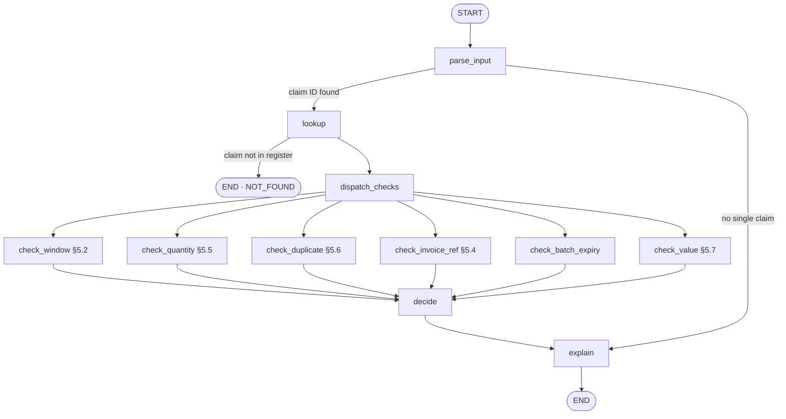

# Project Sankalp: architecture note

**As built · checked against `starter/agent/graph.py` on 24 November 2026 · Fictional training case**

## 1. User, decision, and the split

**User:** the Commercial Finance claims executive (owner Neha Bansal, Controller). **Weekly decision:** for each claim in the register, recommend credit, reject, or send it to a person. The pilot is read-only: it posts no credit notes and writes nothing to SAP or WMS.

**Code decides; the model only parses and explains.** Every rule, date, join and sum runs in Python. Policy numbers live in [`config.py`](../starter/config.py) with their CO-POL-014 clause, and the date and quantity rules are in [`agent/rules.py`](../starter/agent/rules.py). The model is called in at most two places, and neither one can change the route.

## 2. Graph

| Node | Code or model | Why | File |
|---|---|---|---|
| `parse_input` | Code first: regex for `CLM-YYMM-NNNNN` and `EML-NNN`. **Model only if neither is present:** structured output into `ClaimExtraction`, which has no decision field (`extra="forbid"`). | Claim and email IDs are exact, so a model adds risk. Messy free text needs extraction. | `agent/graph.py`, `agent/prompts.py` |
| `lookup` | Code | Fetches the claim, batch, SKU, stockist, sales rows and credited claims once, each with `source_file` and `source_row`. | `agent/graph.py`, `agent/data.py` |
| six `check_*` nodes | Code, in parallel within one superstep | Each check returns `pass`, `fail` or `missing`, plus a reason, a clause and the cited rows. | `agent/graph.py`, `agent/rules.py` |
| `decide` | Code | Applies a fixed route priority (below). | `agent/graph.py` |
| `explain` | **Model**, with a code guard | Writes 3–5 plain sentences. The guard rejects any number not present in the checks, any approval wording, or the wrong sentence count, and swaps in a code-written fallback. | `agent/graph.py`, `agent/prompts.py` |

## 3. Checks, data and clauses

| Check | CSVs it reads | Rule | Clause |
|---|---|---|---|
| `window` | `expiry_claims`, `batch_master` (expiry claims); `primary_sales` invoice date (breakage, short supply) | The type comes from the dates, not the label. Near expiry: −90 to 0 days; expired: 0 to +90; transit: ≤ 7 days after invoice. Inclusive. | §5.2 |
| `quantity` | `primary_sales`, all rows for the stockist and batch | Claimed packs ≤ invoiced + free packs. | §5.5 |
| `duplicate` | `expiry_claims`, credited rows | An earlier credited claim with the same stockist, batch and quantity is a fail. | §5.6 |
| `invoice_ref` | `expiry_claims`, `primary_sales` | The reference must be present and match a sales row. If not, `missing`: §5.4 needs a ledger check and the Area Manager's written approval, which are not in the data. | §5.4 |
| `batch_expiry` | `expiry_claims`, `batch_master` | The claimed expiry must equal the batch-master expiry. | §5.2 / §5.3 |
| `value` | `expiry_claims`, `sku_master` | Claim value = quantity × PTS, using Decimal arithmetic. | §5.7 |

**Decide rules, in order:** (1) any `fail` on window, duplicate or quantity → **REJECT**; (2) the input was an email (`EML-`) → **NEEDS_PERSON**, because correspondence is untrusted; (3) any other `fail` or `missing` → **NEEDS_PERSON**; (4) otherwise → **RECOMMEND_CREDIT**. If the claim isn't in the register → **NOT_FOUND**, with no model call.

**Whole register, code only** (4,503 claim rows, Apr 2024–Sep 2026): 2,112 recommend credit, 532 reject, 1,859 needs a person. Most of the needs-a-person claims lack an invoice reference (1,823) or have a batch that isn't in the master (970). The two groups overlap.

## 4. Failure handling

| Failure | Response | Test |
|---|---|---|
| Unknown claim ID | `NOT_FOUND`, 0 model calls | `test_ask_not_found_does_not_call_model`; check set `not_found_01` |
| Email tells the system to skip checks (EML-017) | Body tagged `untrusted_correspondence`; route forced to `NEEDS_PERSON`; "APPROVED" text is stripped | `test_email_prompt_injection_is_untrusted_and_cannot_return_approval`, `test_ask_keeps_eml_017_untrusted_and_never_approves` |
| Free text with no claim number | `NEEDS_PERSON` (`input_parse: missing`) | `test_unidentifiable_free_text_is_routed_to_a_person` |
| Provider down or key missing during parse | Exception caught → `NEEDS_PERSON` | `test_provider_failure_during_parse_routes_to_a_person` |
| Provider down during explain | Code route kept; code fallback text | `test_provider_failure_during_explain_keeps_code_route_and_uses_fallback` |
| Model adds a number, approval wording, or says an action was taken ("has been rejected") | Fallback explanation | `test_model_explanation_cannot_add_numbers_not_present_in_checks`, `test_explanation_cannot_present_the_route_as_an_action_already_taken` |
| Value ≠ quantity × PTS | `value: fail` → `NEEDS_PERSON` | `test_claim_value_mismatch_is_sent_to_a_person` |
| Provider hangs | **Gap:** no explicit model or request timeout is configured; the Vercel function limit is the only cap | None yet |
| Batch, sales or invoice row missing; bad date or quantity | Check returns `missing` → `NEEDS_PERSON`, never a guess | check set `missing_batch_01`, `blank_invoice_01/02`; date and quantity tests in `test_rules.py` |

`pytest -q`: **90 passed**; the frontend Node tests pass **17/17** (`test_frontend.js` and `test_evidence.js`). The tests cover every boundary in `rules.py` (day 90, day 7, the 60% shelf-life threshold, the 3% cap, PTS value). `agent/tools.py` (earlier tool loop) is unit-tested but **not wired into the graph**.

## 5. Accuracy

| Version | Check set (16 hand-checked) | Held-out (6, labelled after the build) |
|---|---|---|
| Starter tool loop (commit `a22bdcc`) | 6/16 | — |
| Claims graph (current) | **16/16** | **3/6** |

Run `python checks/run_checks.py`; it scores held-out (`holdout_`) cases separately. The live URL gives the same scores. **Held-out failures (known gaps):** (a) a pasted message that names a claim *and* states a different expiry or value is credited from the register; the pasted fields aren't compared against it. (b) A repeat of an earlier **pending** claim (CLM-2608-02222 → CLM-2609-04449, same stockist, batch and 547 packs) is missed, because `check_duplicate` only looks at credited claims. Passed: the day-90 boundary, a label that contradicts the dates, and a pasted email with no claim ID.

## 6. Speed and cost (measured 24 Nov 2026, `openai/gpt-4o-mini` via OpenRouter)

| Input | Route | Model calls | Tokens in / out | Seconds | Cost (USD) |
|---|---|---:|---:|---:|---:|
| CLM-2404-04177 (clean) | RECOMMEND_CREDIT | 1 | 825 / 56 | 2.7 | 0.000157 |
| CLM-2605-04488 (duplicate) | REJECT | 1 | 848 / 72 | 1.9 | 0.000170 |
| CLM-2412-00383 (outside window) | REJECT | 1 | 824 / 66 | 1.8 | 0.000163 |
| CLM-2404-04181 (no invoice) | NEEDS_PERSON | 1 | 764 / 67 | 1.9 | 0.000155 |
| Free text, no claim ID | NEEDS_PERSON | 2 | 520 / 96 | 3.5 | 0.000136 |

The figures are the mean of 2 runs each, measured with LangChain's usage callback and priced at OpenRouter's list rates ($0.15 per M input tokens, $0.60 per M output). **About 4,000 claims a year** (interview notes, p. 2) × ~$0.00016 ≈ **$0.65 a year** in model cost. Hosting costs are excluded. Claim reviews take 1.4–3.6 s locally and 2–2.7 s on the live URL; NOT_FOUND takes 0.005 s.

## 7. Deployment

Vercel Hobby at [project-pfizer.vercel.app](https://project-pfizer.vercel.app) (`/api/health`), root `pfizer-channel-engagement_learner-pack/starter`, env vars `OPENROUTER_API_KEY` and `MODEL`. FastAPI serves `/api/*`; `public/` is static. **Region `bom1`** (Mumbai), pinned in `vercel.json` and confirmed by the live `x-vercel-id` header (it was `iad1`, US East, before 24 Nov). The repo is private; the owner merges PRs to `master`, which deploys.
