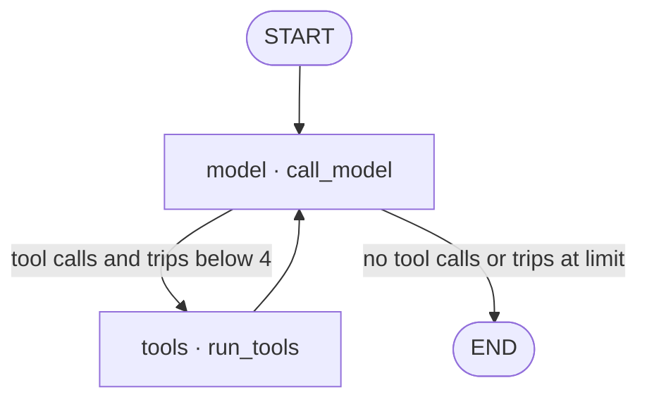

# Project Sankalp: implemented architecture

**As-built scope · checked against `starter/` on 24 November 2026**

## Users and weekly decisions

**Primary user:** Commercial Finance claims executive, owned by Neha Bansal (Controller). The weekly job is to review each registered claim and decide whether to credit, reject, or route it for a person's review. The app currently provides screening evidence only; it does not make any of those decisions. **Secondary user:** Kavita Rao (Head of Supply Chain), reviewing expiry-risk batches and short CFAs. The names and workflow context come from the case interviews ([`04_stakeholder_interview_notes.pdf`](../data-pack/04_stakeholder_interview_notes.pdf)); the implemented read-only tools are in [`starter/agent/tools.py`](../starter/agent/tools.py).

## App and graph

The static single-page UI calls a FastAPI endpoint; that endpoint invokes a LangGraph model/tool loop and returns an answer, structured evidence, and model-call count. The app does not write to ERP/WMS or post credits ([`starter/public/index.html`](../starter/public/index.html), [`starter/public/app.js`](../starter/public/app.js), [`starter/app.py`](../starter/app.py), [`starter/agent/graph.py`](../starter/agent/graph.py)).

The diagram is derived from the compiled graph in [`starter/agent/graph.py`](../starter/agent/graph.py). `route()` is a conditional edge, not a node.

| Node | What runs | Why code / why model | Source |
|---|---|---|---|
| `model` / `call_model` | OpenRouter chat model with the registered tools bound; message history and system instructions are sent on each trip. | Model interprets free-form questions, chooses a tool, and explains returned evidence. It is instructed not to invent facts or approve claims. | [`starter/agent/graph.py`](../starter/agent/graph.py), [`starter/agent/llm.py`](../starter/agent/llm.py) |
| `tools` / `run_tools` | Python dispatches tool calls and serializes exact results as `ToolMessage`s. | Code reads records and applies arithmetic/date rules so factual values and policy screens come from source rows; the model cannot change them. | [`starter/agent/graph.py`](../starter/agent/graph.py), [`starter/agent/tools.py`](../starter/agent/tools.py), [`starter/agent/rules.py`](../starter/agent/rules.py) |

`MAX_TRIPS = 4`; the graph ends when there are no tool calls or the counter reaches four. `run_question()` collects tool evidence and applies a deterministic response for EML-017 so that its hostile text cannot produce a claim decision ([`starter/agent/graph.py`](../starter/agent/graph.py)).

## Tools and data

Tools are registered in [`starter/agent/tools.py`](../starter/agent/tools.py); CSV paths resolve under [`starter/data/`](../starter/data/).

| Tool | CSV files read | Output |
|---|---|---|
| `lookup_batch` | `batch_master.csv`, `sku_master.csv` | Batch and product facts, or not-found. |
| `review_expiry_claim` | `expiry_claims.csv`, `batch_master.csv`, `primary_sales.csv`, `sku_master.csv`, `stockist_master.csv` | Claim evidence, possible prior credit, batch/invoice checks, quantity comparison, and expiry-window screen; never approves or rejects. |
| `lookup_claim_email` | `claim_emails.csv` | Email text with source row and `untrusted_correspondence` status. |
| `find_short_shelf_life_shipments` | `primary_sales.csv`, `batch_master.csv` | RSL exceptions and unevaluable rows; CO-POL-014 §7.1 defines RSL on the invoice date. [`starter/agent/rules.py`](../starter/agent/rules.py) computes the percentage. |
| `find_cfa_stock_imbalances` | `cnf_stock_snapshot.csv`; optionally `sku_master.csv` | Latest-snapshot zero-stock versus positive-batch signals; no excess-stock conclusion or transfer recommendation. |
| `forecast_primary_shipments` | `primary_sales.csv` | Same-month-last-year primary-shipment baseline and order-gap diagnostics; not downstream demand. |

## Failure handling and tests

The table maps important failure paths to focused tests in [`starter/tests/test_tools.py`](../starter/tests/test_tools.py), [`starter/tests/test_rules.py`](../starter/tests/test_rules.py), and [`starter/tests/test_api.py`](../starter/tests/test_api.py).

| Case | Implemented response | Coverage |
|---|---|---|
| Unknown batch, claim, or email | Returns not-found; unknown claim remains `NEEDS_HUMAN_REVIEW`. | `test_unknown_batch_is_reported_not_invented`, `test_claim_audit_unknown_claim_fails_closed`, `test_claim_email_lookup_returns_not_found_for_unknown_id` (`test_tools.py`). |
| Required CSV missing | Names the missing file(s) in the result. | `test_claim_audit_reports_missing_data_files`, `test_shelf_life_report_reports_missing_input_files`, `test_stock_imbalance_validates_limit_and_missing_file` (`test_tools.py`). |
| Invalid dates/quantities, missing batch dates, SKU mismatch, or threshold edge | Rejects invalid rule inputs or reports rows as unevaluable; 60% exactly is not flagged. | `test_missing_date_is_rejected`, `test_expiry_must_be_after_manufacture_date`, `test_pack_quantity_rejects_missing_invalid_or_negative_values` (`test_rules.py`); shelf-life edge tests in `test_tools.py`. |
| Ambiguous stock or invalid controls | Excludes conflicting stock groups with a quality issue; invalid limits/forecast parameters return errors. | Stock and forecast control tests in `test_tools.py`. |
| Invalid forecast source quantity or missing baseline month | Withholds malformed forecast input; does not assume a missing prior-year month is zero. | `test_primary_shipment_forecast_withholds_results_for_invalid_source_quantity`, `test_primary_shipment_forecast_uses_prior_year_month_and_keeps_provenance` (`test_tools.py`). |
| EML-017 says to skip checks and approve | Email is returned as untrusted evidence; a fixed post-graph response replaces the model answer, so the adversarial model output cannot approve the claim. | `test_eml_017_injection_is_untrusted_and_cannot_produce_approval` (`test_api.py`); lookup status is also checked by `test_claim_email_lookup_returns_untrusted_text_with_source_row` (`test_tools.py`). |
| Missing API key / invalid request body | Missing key raises `ValueError` and maps to HTTP 503; FastAPI request validation returns HTTP 422. | No focused tests currently cover these API errors ([`starter/agent/llm.py`](../starter/agent/llm.py), [`starter/app.py`](../starter/app.py)). |
| Provider/tool error or four-trip exhaustion | Only `ValueError` is caught by the API; other exceptions are not handled there. The graph stops at four trips without an explicit incomplete-result status. | No focused tests currently cover these paths ([`starter/app.py`](../starter/app.py), [`starter/agent/graph.py`](../starter/agent/graph.py)). |

**Verification:** `pytest -q` from `starter/` completed with **68 passed**.

## Deployment, latency, and cost

| Item | As configured / measured |
|---|---|
| Live UI | [https://project-pfizer.vercel.app](https://project-pfizer.vercel.app) |
| Vercel root | `starter/`, per [`starter/README.md`](../starter/README.md). |
| Environment variables | Required: `OPENROUTER_API_KEY`. Optional: `MODEL`, default `openai/gpt-4o-mini`. The app calls OpenRouter at `https://openrouter.ai/api/v1` ([`starter/agent/llm.py`](../starter/agent/llm.py)). |
| Region | No `regions` setting is present in [`starter/vercel.json`](../starter/vercel.json). The deployment's actual region is a Vercel project setting and could not be verified from this checkout; the local CLI has no credentials. |
| Seconds per request | Not measured. The five earlier real `/api/ask` samples recorded token counts but no durations; the live host could not be reached from this environment, so there is no defensible latency figure here. |

Five earlier real `/api/ask` samples used `openai/gpt-4o-mini`; the observed model usage and estimated cost were:

| Sample | Input tokens | Output tokens | Model calls | Estimated cost (USD) |
|---|---:|---:|---:|---:|
| Batch expiry lookup | 1,335 | 37 | 2 | $0.00022245 |
| Shelf-life scan | 4,993 | 712 | 2 | $0.00117615 |
| CFA stock review | 10,280 | 1,102 | 2 | $0.00220320 |
| Shipment baseline | 14,671 | 494 | 2 | $0.00249705 |
| Claim evidence review | 2,420 | 708 | 2 | $0.00078780 |
| **Total / mean** | **33,699 / 6,740** | **3,053 / 611** | **10 / 2** | **$0.00688665 / $0.00137733** |

The estimate uses OpenRouter's listed GPT-4o-mini rates ($0.15/M input tokens, $0.60/M output tokens): `(input × 0.15 + output × 0.60) / 1,000,000` ([model pricing](https://openrouter.ai/openai/gpt-4o-mini)). For **about 4,000 claims/year**, one claim-review request per claim at the observed claim-review sample cost is approximately **$3.15/year** in model charges. This is an extrapolation from one claim sample, excludes Vercel/hosting and other costs, and assumes the same prompt/evidence size and model; it is not a measured annual bill. The mixed-question mean would imply about $5.51/year, but is less representative of claims.

## Next

- Capture per-request duration, model, token use, and cost in runtime telemetry.
- Verify the production Vercel region and environment-variable configuration in the project dashboard.
- Add explicit API error and tool-loop exhaustion handling with tests before operational use.
