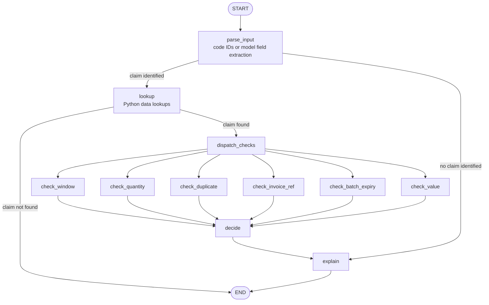

# Project Sankalp: implemented pilot architecture

**As built · checked against `starter/` on 24 November 2026**

## Users and weekly decision

**Primary user:** Commercial Finance claims executive; owner Neha Bansal (Controller). Weekly decision: review a claim and recommend credit, reject under a hard rule, or route to a person. The UI handles one input at a time and does not issue credit. This follows Neha's request for pre-checks for her two-person team ([interviews, p. 2](../data-pack/04_stakeholder_interview_notes.pdf); [Discovery note §4](Discovery_note.md#4-pilot-user-and-plan-for-the-money)).

**Secondary user:** Kavita Rao (Head of Supply Chain), who needs expiry-risk batches and short CFAs ([interviews, p. 2](../data-pack/04_stakeholder_interview_notes.pdf)). That workflow is **not implemented** here. Deterministic checks, row citations, and read-only operation reflect the case accuracy requirement and preserve human credit authority ([UI](../starter/public/index.html), [API](../starter/app.py)).

## Graph and nodes

The diagram follows the nodes, conditional routes, and fan-out/fan-in edges in [`starter/agent/graph.py`](../starter/agent/graph.py). `dispatch_checks` is a synchronization/fan-out node. The six checks run in parallel and join before `decide`.

| Node | Code or model | Why it runs |
|---|---|---|
| `parse_input` | Python + model | Match IDs in code; model extracts fields only. Prompt: [`agent/prompts.py`](../starter/agent/prompts.py). |
| `lookup` | Python + [`agent/data.py`](../starter/agent/data.py) | Fetch claim and related master, billing, and prior-credit rows. |
| `dispatch_checks` | Python | Fan out the six checks. |
| `check_window` | Python + [`agent/rules.py`](../starter/agent/rules.py) | Apply filing windows. |
| `check_quantity` | Python + rules | Compare claimed to invoiced + free packs. |
| `check_duplicate` | Python + rules | Match earlier credited stockist/batch/quantity. |
| `check_invoice_ref` | Python | Match invoice reference to sales. |
| `check_batch_expiry` | Python + rules | Compare claim and batch-master expiry. |
| `check_value` | Python + rules | Compare claim value to quantity × PTS; mismatch → person. |
| `decide` | Python | Apply fixed route priority. |
| `explain` | Model + Python | Explain route/checks; validate output and fall back to code. |

## Lookups, checks, and policy references

[`agent/data.py`](../starter/agent/data.py) caches and de-duplicates CSVs and adds source rows. Rules/clauses are in [`config.py`](../starter/config.py) and [`agent/rules.py`](../starter/agent/rules.py). The legacy functions in `agent/tools.py` are not called by this graph.

| Lookup/check | CSV files read | Config policy clause |
|---|---|---|
| Email lookup | `claim_emails.csv` | Untrusted correspondence; no decision clause. |
| Claim / batch / SKU / stockist | `expiry_claims.csv`; `batch_master.csv`; `sku_master.csv`; `stockist_master.csv` | Lookup only. |
| Invoice sales / prior credits | `primary_sales.csv`; `expiry_claims.csv` | Lookup only. |
| `check_window` | `expiry_claims.csv` + `batch_master.csv` (expiry); `expiry_claims.csv` + `primary_sales.csv` (transit) | CO-POL-014 §5.2 |
| `check_quantity` | `expiry_claims.csv`, `primary_sales.csv` | CO-POL-014 §5.5 |
| `check_duplicate` | `expiry_claims.csv` | CO-POL-014 §5.6 |
| `check_invoice_ref` | `expiry_claims.csv`, `primary_sales.csv` | CO-POL-014 §5.4 |
| `check_batch_expiry` | `expiry_claims.csv`, `batch_master.csv` | `BATCH_EXPIRY_POLICY_CLAUSE` = CO-POL-014 §5.2 (`config.py`) |
| `check_value` | `expiry_claims.csv`, `sku_master.csv` | CO-POL-014 §5.7 |

## Failure paths and coverage

| Situation | Implemented behavior | Test coverage |
|---|---|---|
| Claim ID not found | `NOT_FOUND`, with no check or explanation model call. | `test_claim_graph_covers_recommend_reject_needs_person_and_not_found` (`tests/test_graph.py`); `test_ask_not_found_does_not_call_model` (`tests/test_api.py`). |
| Missing or conflicting evidence | Missing checks and non-priority mismatches route to `NEEDS_PERSON`; failed window, duplicate, or quantity checks route to `REJECT`. | `test_claim_graph_covers_recommend_reject_needs_person_and_not_found`; `test_claim_value_mismatch_is_sent_to_a_person` (`tests/test_graph.py`). |
| EML-017 prompt injection | Email is marked `untrusted_correspondence`; claimed approvals are not followed. | `test_email_prompt_injection_is_untrusted_and_cannot_return_approval` (`tests/test_graph.py`); `test_ask_keeps_eml_017_untrusted_and_never_approves` (`tests/test_api.py`). |
| Model extraction/explanation error | Exceptions route unparsed input to a person or use a code-generated explanation while preserving route. | Behavior exists in `agent/graph.py`; **no dedicated provider-exception test currently covers the fallback**. |
| Request timeout | No explicit model/API/graph timeout is configured. | **Not implemented; no timeout test.** |

Current local verification: `pytest -q` passed **87 tests**; frontend Node tests passed **16/16**. The focused model-error fallback and timeout gaps above remain open.

## Check set

Baseline commit `a22bdcc` records **6/16**: the evidence-only graph had no route field, so recommend/reject could not be evaluated deterministically. Current [`checks/run_checks.py`](../starter/checks/run_checks.py) reads `route` and scored **16/16 locally** on those cases. No failures remain; this is not a live score.

## Live cost, speed, and deployment

The graph returns model-call count and elapsed seconds, but captures no tokens or provider cost ([`agent/graph.py`](../starter/agent/graph.py), [`agent/llm.py`](../starter/agent/llm.py)). The live host did not resolve here; five live samples are unavailable.

| Requested measurement | Verified status |
|---|---|
| Five live `/api/ask` requests: calls, tokens, seconds, USD | **Not measured.** DNS failed here and the deployed version is unconfirmed. Previous note's measurements were for the old tool-loop graph. |
| Approximate yearly model cost for 4,000 claims | **Not computable.** After five live samples, use `4,000 × mean USD/request`, actual token counts, deployed model pricing, and the claim mix. |
| Live URL | [project-pfizer.vercel.app](https://project-pfizer.vercel.app) is recorded in the prior note; DNS failed here on 24 Nov 2026. |
| Host / plan | Vercel; Hobby was user-reported but is not verifiable in this repository. |
| Environment variables | `OPENROUTER_API_KEY` required; `MODEL` optional, defaults to `openai/gpt-4o-mini` ([`.env.example`](../starter/.env.example), [`agent/llm.py`](../starter/agent/llm.py)). Deployed values unavailable. |
| Region | No `regions` in `vercel.json`; actual region unverified without dashboard access. |

## Next

- Add and test explicit provider timeouts and model-error fallback; test timeout routes and route preservation.
- Capture model ID, token counts, per-request seconds, and price for five live requests; then calculate the 4,000-claim annual estimate and verify Vercel plan/region.
- Decide whether Kavita's supply-chain view is a separate future workflow; it is not part of this claims pilot today.
