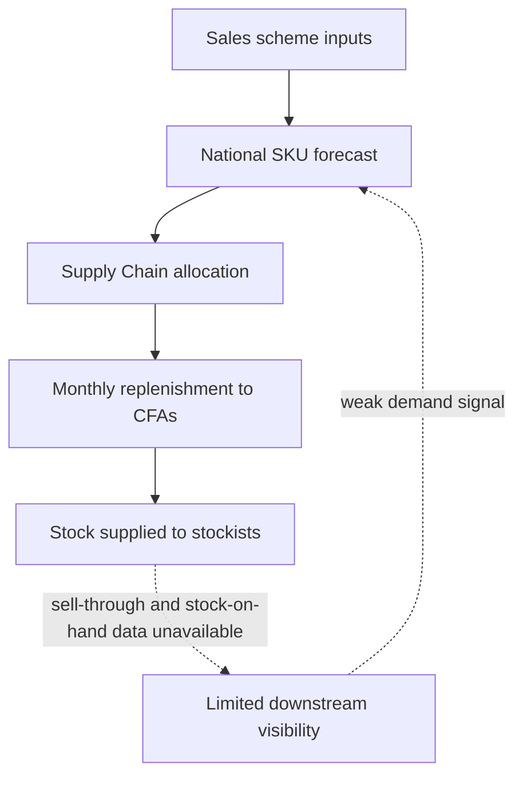

# How Pfizer’s General Medicines channel works

The channel has three connected parts: **products move downstream**, planning decisions move stock into the network, and expiry or near-expiry stock can return as a claim.

## 1. Product flow

## 2. Planning and stock visibility

## 3. Expiry and near-expiry claims

## What this means

Pfizer can see its primary shipments and some CFA inventory, but the project pack says stockist sell-through is not centrally available. That makes it harder to know whether stock sent into the channel is moving to customers or aging downstream. The supplied data also shows signs of uneven CFA stock and some shipments that may have less shelf life than policy allows. These are reasons to investigate planning and execution; they do not prove the cause of returns or stockouts.

The CFA agreement calls for monthly replenishment and batch-level FEFO handling. Returns are checked against batch, quantity, prior claims, and policy before Finance processes a credit note. Existing business owners retain approval authority. [Company and channel overview](../data-pack/01_company_and_channel_overview.pdf) [Trade terms and returns policy](../data-pack/02_trade_terms_and_returns_policy.pdf) [C&F agreement and SOP](../data-pack/03_cnf_agreement_and_sop.pdf)

## Sources

- [QBR finance and MIS pack](../data-pack/06_qbr_finance_and_mis_pack.pdf)
- [Discovery findings](business_problem_validation.md)
