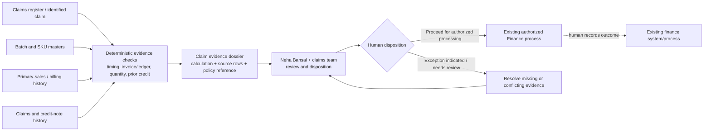
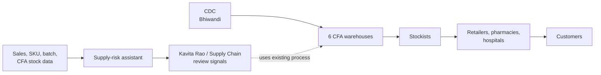
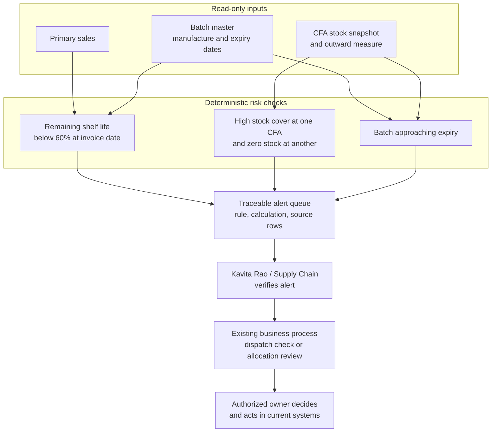

# Proposed two-workflow solution in the case business flow

The proposed read-only copilot supports two separate weekly decisions. The first workflow serves Commercial Finance claims triage; the second serves Supply Chain availability and aging-risk review. It sits alongside existing processes and does not make credit, rejection, transfer, or allocation decisions.

## 1. Primary workflow: Commercial Finance claims triage

The target user is Controller Neha Bansal and the two-person claims team described in the case materials. The tool should present **candidate to proceed for authorized review**, **exception indicated**, or **needs human review**; it must not label a claim automatically approved or rejected. The code can review an identified claim and surface some evidence today, but a complete register workflow and every policy path are not implemented or policy-validated. CO-POL-014 §§5.2, 5.4, 5.5, and 5.6 must be confirmed against the source PDF before operational use.

## 2. Existing product flow with the assistant alongside it

The product continues through the same distribution chain. The copilot does not sit in the product or transaction path. It supports separate Commercial Finance claim review and Supply Chain planning/inventory review; current business systems retain transaction authority.

## 3. Secondary workflow: Supply Chain availability and aging-risk review

## What changes for the teams

- **Commercial Finance** gets a traceable dossier to help the claims team check evidence before an authorized person records a disposition.
- **Supply Chain** gets visibility of potential CFA/SKU imbalances and short-shelf-life shipment lines that may need review. The current app does not yet generate a forward-looking batch-expiry inventory queue.
- **CFA operations** gets a clear shelf-life flag with the invoice date, batch dates, remaining-life calculation, and source line.
- **Reviewers** can see why an alert appeared and verify it before taking it forward.
- **Current owners** keep control of allocation changes, dispatch decisions, transfers, and approvals. The pilot does not write to ERP or WMS, move stock, or approve actions.

CO-POL-014 §7.1 defines the shelf-life check at invoice date, and the assistant applies that rule. The stock alert is a review signal, not a transfer recommendation: stockist sell-through is not available in the supplied pack, and CFA stock alone does not establish downstream demand.

## Sources

- [Current discovery scope](Discovery_note.md)
- [Earlier pilot charter (archived)](archive/pilot_charter.md)
- [Business flow](channel_business_flow.md)
- [Trade terms and returns policy](../data-pack/02_trade_terms_and_returns_policy.pdf)
- [Company and channel overview](../data-pack/01_company_and_channel_overview.pdf)
- [C&F agreement and SOP](../data-pack/03_cnf_agreement_and_sop.pdf)
