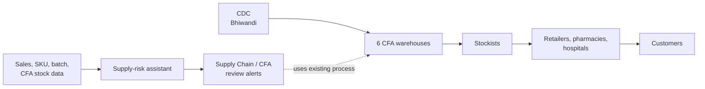
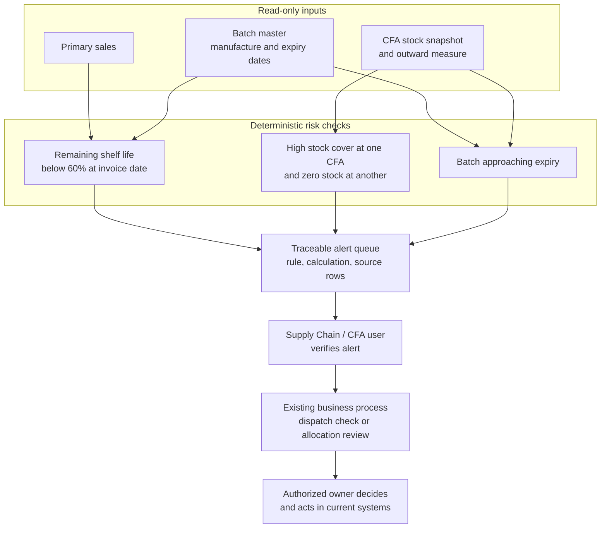

# Proposed solution in Pfizer’s business flow

The proposed assistant sits alongside the existing distribution process. It reads the supplied sales, batch, and CFA stock data, checks for operational risks, and gives the relevant team a traceable alert to review.

## 1. Existing product flow with the assistant alongside it

The product continues through the same distribution chain. The assistant does not sit in the product or transaction path; it supports the people who review planning, dispatch, and inventory risks.

## 2. What the assistant checks and what happens next

## What changes for the teams

- **Supply Chain** gets earlier visibility of potential CFA/SKU imbalances and batches that may need review.
- **CFA operations** gets a clear shelf-life flag with the invoice date, batch dates, remaining-life calculation, and source line.
- **Reviewers** can see why an alert appeared and verify it before taking it forward.
- **Current owners** keep control of allocation changes, dispatch decisions, transfers, and approvals. The pilot does not write to ERP or WMS, move stock, or approve actions.

CO-POL-014 §7.1 defines the shelf-life check at invoice date, and the assistant applies that rule. The stock alert is a review signal, not a transfer recommendation: stockist sell-through is not available in the supplied pack, and CFA stock alone does not establish downstream demand.

## Sources

- [Pilot charter](archive/pilot_charter.md)
- [Business flow](channel_business_flow.md)
- [Trade terms and returns policy](../data-pack/02_trade_terms_and_returns_policy.pdf)
- [Company and channel overview](../data-pack/01_company_and_channel_overview.pdf)
- [C&F agreement and SOP](../data-pack/03_cnf_agreement_and_sop.pdf)
